# 8. ER Diagram

Diagramme Mermaid (rendu sur GitHub ou avec une extension Mermaid dans VS Code).

Lecture : `||` = exactement 1 (obligatoire), `o|` = 0 ou 1, `o{` = 0 à N, `|{` = 1 à N.

```mermaid
erDiagram
    CITY ||--o{ STATION : "contient"
    RAILWAY_LINE ||--|{ LINE_STATION : "ordonne"
    STATION ||--o{ LINE_STATION : "est desservie"

    TRAIN ||--|{ CARRIAGE : "compose"
    CARRIAGE ||--|{ SEAT : "contient"

    RAILWAY_LINE ||--o{ JOURNEY : "parcourue par"
    TRAIN ||--o{ JOURNEY : "assure"
    JOURNEY ||--|{ JOURNEY_STOP : "s'arrete"
    STATION ||--o{ JOURNEY_STOP : "accueille"

    PASSENGER ||--o{ PASSENGER_DOCUMENT : "possede"
    PASSENGER ||--o{ BOOKING : "effectue"
    BOOKING ||--|{ TICKET : "contient"
    BOOKING ||--o{ PAYMENT : "tentatives"
    JOURNEY_STOP ||--o{ TICKET : "origine"
    JOURNEY_STOP ||--o{ TICKET : "destination"
    SEAT ||--o{ TICKET : "attribue"
    TICKET ||--o| REFUND : "rembourse"
    PAYMENT ||--o{ REFUND : "source"

    RAILWAY_LINE ||--o{ PRICING_RULE : "tarifee par"
    TICKET ||--o{ TICKET_DISCOUNT : "beneficie"
    DISCOUNT ||--o{ TICKET_DISCOUNT : "appliquee"

    PASSENGER ||--o| LOYALTY_ACCOUNT : "detient"
    LOYALTY_ACCOUNT ||--o{ LOYALTY_TRANSACTION : "historise"
    TICKET |o--o{ LOYALTY_TRANSACTION : "genere"
    REWARD |o--o{ LOYALTY_TRANSACTION : "consommee"

    EMPLOYEE ||--o{ DRIVER_LICENCE : "titulaire"
    EMPLOYEE ||--o{ JOURNEY_CREW : "affecte"
    JOURNEY ||--o{ JOURNEY_CREW : "equipage"

    TRAIN ||--o{ MAINTENANCE : "subit"
    TRAIN ||--o{ INCIDENT : "concerne"
    JOURNEY |o--o{ INCIDENT : "survient pendant"
    JOURNEY_STOP ||--o{ DELAY : "retard"
    JOURNEY |o--o| CANCELLATION : "annule"
    TICKET |o--o| CANCELLATION : "annule"

    CITY { int city_id PK }
    STATION { int station_id PK
              int city_id FK
              string code UK }
    RAILWAY_LINE { int line_id PK
                   string code UK }
    LINE_STATION { int line_id PK, FK
                   int stop_order PK
                   int station_id FK
                   decimal distance_from_prev_km }
    TRAIN { int train_id PK
            string code UK }
    CARRIAGE { int carriage_id PK
               int train_id FK
               int carriage_no
               string travel_class }
    SEAT { int seat_id PK
           int carriage_id FK
           int seat_no }
    JOURNEY { int journey_id PK
              int line_id FK
              int train_id FK
              date service_date
              string status }
    JOURNEY_STOP { int journey_id PK, FK
                   int stop_order PK
                   int station_id FK
                   datetime planned_arrival
                   datetime actual_arrival }
    PASSENGER { int passenger_id PK
                string email UK }
    PASSENGER_DOCUMENT { int document_id PK
                         int passenger_id FK }
    BOOKING { int booking_id PK
              int passenger_id FK
              string status
              decimal total_amount }
    TICKET { int ticket_id PK
             int booking_id FK
             int journey_id FK
             int origin_station_id FK
             int dest_station_id FK
             int seat_id FK
             decimal price
             string status }
    PAYMENT { int payment_id PK
              int booking_id FK
              decimal amount
              string status }
    REFUND { int refund_id PK
             int ticket_id FK, UK
             int payment_id FK
             decimal amount }
    PRICING_RULE { int rule_id PK
                   int line_id FK
                   datetime valid_from
                   datetime valid_to }
    DISCOUNT { int discount_id PK
               string code UK }
    TICKET_DISCOUNT { int ticket_id PK, FK
                      int discount_id PK, FK }
    LOYALTY_ACCOUNT { int account_id PK
                      int passenger_id FK, UK
                      int points_balance }
    LOYALTY_TRANSACTION { int transaction_id PK
                          int account_id FK
                          int ticket_id FK
                          int reward_id FK
                          int points }
    REWARD { int reward_id PK
             int points_cost }
    EMPLOYEE { int employee_id PK
               string job_role }
    DRIVER_LICENCE { int licence_id PK
                     int employee_id FK
                     date expires_on }
    JOURNEY_CREW { int journey_id PK, FK
                   int employee_id PK, FK }
    MAINTENANCE { int maintenance_id PK
                  int train_id FK }
    INCIDENT { int incident_id PK
               int train_id FK
               int journey_id FK }
    DELAY { int delay_id PK
            int journey_id FK
            int station_id FK
            int minutes }
    CANCELLATION { int cancellation_id PK
                   int journey_id FK
                   int ticket_id FK }
    AUDIT_LOG { bigint audit_id PK
                string table_name
                string record_id }
```

## Points à montrer

- **Achat de billets** : `PASSENGER 1—N BOOKING 1—N TICKET`, et `BOOKING 1—N PAYMENT` (plusieurs tentatives, une seule réussie compte).
- **Billet → segment de trajet** : `TICKET` pointe deux fois vers `JOURNEY_STOP` via `(journey_id, origin_station_id)` et `(journey_id, dest_station_id)`. Le segment est l'intervalle entre les deux `stop_order`.
- **Trajet → gares** : `JOURNEY 1—N JOURNEY_STOP N—1 STATION` (N:N résolue, ordonnée par `stop_order`). La ligne suit le même schéma avec `LINE_STATION`.
- **Structure d'un train** : `TRAIN 1—N CARRIAGE 1—N SEAT` ; un billet réserve un `SEAT`.
- `AUDIT_LOG` est volontairement isolée (référence générique `table_name` + `record_id`).
